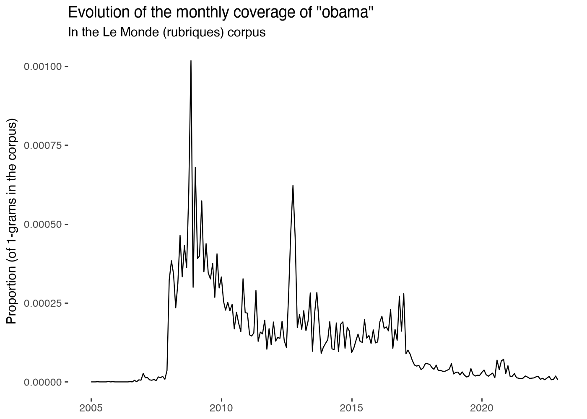
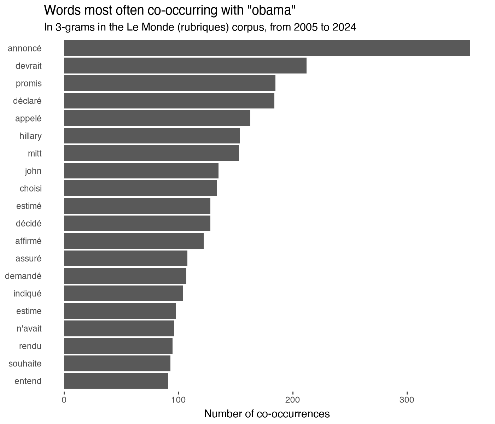

# pyllicagram

This vignette introduces the main functions in the package and provides examples of simple analyses that can be carried out with these functions. It is adapted from the [vignette of `rallicagram`](https://vincentbagilet.github.io/rallicagram/articles/rallicagram.html), the R package by Vincent Bagilet of which `pyllicagram` is a port.

More information is available in the documentation of each function, accessible by typing `help(gallicagram)` in the console for instance, for the `gallicagram` function.


## Main functions

### Occurrences

The main function in this package, `gallicagram`, builds a data frame with the yearly, monthly or daily proportion of mentions of a term in one of the corpora.

For the *Le Monde* corpus, this function allows to compute the number of newspaper articles that mention the keywords (parameter `n_of="articles"`).

``` python
ex_occur = gallicagram(
    keyword="président",
    corpus="lemonde",
    from_=1960,
    to=1970,
    resolution="monthly",
)
```

Here is an example of the first rows of the output:

| date | keyword | n_occur | n_total | prop_occur | year | month | corpus | resolution | n_of |
|:---|:---|:---|:---|:---|:---|:---|:---|:---|:---|
| 1960-01-01 | président | 1338 | 872943 | 0.001532746 | 1960 | 1 | lemonde | monthly | 1-grams |
| 1960-02-01 | président | 1360 | 915672 | 0.001485248 | 1960 | 2 | lemonde | monthly | 1-grams |
| 1960-03-01 | président | 1461 | 928764 | 0.001573058 | 1960 | 3 | lemonde | monthly | 1-grams |
| 1960-04-01 | président | 1239 | 772707 | 0.001603454 | 1960 | 4 | lemonde | monthly | 1-grams |
| 1960-05-01 | président | 1355 | 835612 | 0.001621566 | 1960 | 5 | lemonde | monthly | 1-grams |
| 1960-06-01 | président | 1314 | 850245 | 0.001545437 | 1960 | 6 | lemonde | monthly | 1-grams |

### Co-occurrences

`gallicagram_cooccur` builds a data frame with the yearly or monthly proportion of mentions of close co-occurrences of two keywords in one of the corpora for which this function is available (see the `available_func` column of `list_corpora`) between two specified dates.

Close co-occurrences correspond to words that are less than 3 (4 in the *Le Monde* corpus) words away in the initial text. For the *Le Monde* corpus, this function allows to compute the number of co-occurrences within an entire article (parameter `cooccur_level="articles"`).

``` python
ex_cooccur = gallicagram_cooccur(
    keyword_1="président",
    keyword_2="république",
    corpus="lemonde",
    from_=1960,
    to=1970,
    resolution="monthly",
    cooccur_level="articles",
)
```

Here is an example of part of the output:

| date | keyword_1 | keyword_2 | n_cooccur | n_total | prop_cooccur | year | month | corpus | resolution | cooccur_level |
|:---|:---|:---|:---|:---|:---|:---|:---|:---|:---|:---|
| 1960-01-01 | président | république | 224 | 2488 | 0.09003215 | 1960 | 1 | lemonde | monthly | articles |
| 1960-02-01 | président | république | 267 | 2584 | 0.1033282 | 1960 | 2 | lemonde | monthly | articles |
| 1960-03-01 | président | république | 261 | 2561 | 0.1019133 | 1960 | 3 | lemonde | monthly | articles |
| 1960-04-01 | président | république | 187 | 2178 | 0.08585859 | 1960 | 4 | lemonde | monthly | articles |
| 1960-05-01 | président | république | 170 | 2347 | 0.07243289 | 1960 | 5 | lemonde | monthly | articles |
| 1960-06-01 | président | république | 211 | 2419 | 0.08722613 | 1960 | 6 | lemonde | monthly | articles |

### Associations

`gallicagram_associated` builds a data frame with the words most frequently used close to a given keyword over the period. For the *Le Monde* corpus, this function allows to compute the number of co-occurrences within an entire article (parameter `distance="articles"`).

``` python
ex_associated = gallicagram_associated(
    keyword="camarade",
    corpus="lemonde",
    from_=1960,
    to=1970,
    n_results=10,
    distance=2,
)
```

The terms most often associated with "camarade" are:

| associated_word | n_cooccur | keyword | corpus | from | to | cooccur_level |
|:---|:---|:---|:---|:---|:---|:---|
| khrouchtchev | 79 | camarade | lemonde | 1960 | 1970 | 3-grams |
| mao | 43 | camarade | lemonde | 1960 | 1970 | 3-grams |
| rochet | 31 | camarade | lemonde | 1960 | 1970 | 3-grams |
| waldeck | 31 | camarade | lemonde | 1960 | 1970 | 3-grams |
| promotion | 28 | camarade | lemonde | 1960 | 1970 | 3-grams |
| tse | 28 | camarade | lemonde | 1960 | 1970 | 3-grams |
| thorez | 24 | camarade | lemonde | 1960 | 1970 | 3-grams |
| dubcek | 22 | camarade | lemonde | 1960 | 1970 | 3-grams |
| club | 20 | camarade | lemonde | 1960 | 1970 | 3-grams |
| togliatti | 19 | camarade | lemonde | 1960 | 1970 | 3-grams |

## Graphs

One of the main usage of `Gallicagram` is to plot time series of occurrences in a corpus. The function `gallicagraph` enables to do that in only one additional line of code. It takes as input a data frame produced by one of the functions from the package and automatically produces the corresponding graph:

``` python
gallicagraph(gallicagram(keyword="obama", corpus="lemonde", from_=2005))
```



The graphs are [`plotnine`](https://plotnine.org/) objects, the Python port of `ggplot2`: they display automatically in a notebook, can be saved with their `.save()` method and can be modified by adding elements, as in `ggplot2`. The documentation of `rallicagram` uses the `ggplot2` theme [`mediocrethemes`](https://vincentbagilet.github.io/mediocrethemes/) of its author. It has no Python version, so that the graphs below use the default theme. Another theme can be set with `plotnine.theme_set()`.

One can also use the same function to plot words associated with a given keyword:

``` python
gallicagraph(gallicagram_associated(keyword="obama", corpus="lemonde", from_=2005))
```



## More than one keyword

### Occurrences of a lexicon

Each of the main functions described above has a `lexicon` counterpart, adding a suffix `_lexicon` (`gallicagram_lexicon`, `gallicagram_cooccur_lexicon` and `gallicagram_associated_lexicon`). Each function simply loops the initial function over each word of the lexicon(s) and sums the results. It thus computes the sum of (co-)occurrences of each word in the lexicon:

``` python
ex_lexicon = gallicagram_lexicon(
    lexicon=["président", "présidente"],
    corpus="lemonde",
    from_=1960,
    to=1970,
    resolution="monthly",
)

ex_cooccur_lexicon = gallicagram_cooccur_lexicon(
    lexicon_1=["président", "présidente"],
    lexicon_2=["mauvais", "nul"],
    corpus="lemonde",
    from_=1960,
    to=1970,
    resolution="monthly",
    cooccur_level="articles",
)
```

Here is an example of part of the output of `gallicagram_lexicon`:

| date | keyword | n_occur | n_total | prop_occur | year | month | corpus | resolution | n_of | lexicon |
|:---|:---|:---|:---|:---|:---|:---|:---|:---|:---|:---|
| 1960-01-01 | président | 1341 | 872943 | 0.001536183 | 1960 | 1 | lemonde | monthly | 1-grams | président+présidente |
| 1960-02-01 | président | 1362 | 915672 | 0.001487432 | 1960 | 2 | lemonde | monthly | 1-grams | président+présidente |
| 1960-03-01 | président | 1465 | 928764 | 0.001577365 | 1960 | 3 | lemonde | monthly | 1-grams | président+présidente |
| 1960-04-01 | président | 1241 | 772707 | 0.001606042 | 1960 | 4 | lemonde | monthly | 1-grams | président+présidente |
| 1960-05-01 | président | 1358 | 835612 | 0.001625156 | 1960 | 5 | lemonde | monthly | 1-grams | président+présidente |
| 1960-06-01 | président | 1315 | 850245 | 0.001546613 | 1960 | 6 | lemonde | monthly | 1-grams | président+présidente |

These functions are particularly helpful to compute the number of occurrences of words from a whole lexical field (or the plural or feminine form of a keyword, etc).

### Words with the same stem

The function `get_same_stem()` enables to retrieve part of these forms: those that share the same stem as the keyword of interest. For instance, for "écologie":

``` python
get_same_stem("écologie")
#> ['écologie', 'écologique', 'écologiquement', 'écologiques', 'écologiste', 'écologistes']
```

This function is particularly useful when its output is passed to one of the `_lexicon` functions:

``` python
ex_stem_lexicon = gallicagram_lexicon(
    get_same_stem("écologie"),
    corpus="lemonde",
    from_=1960,
    to=1970,
    resolution="yearly",
)
```

Note that due to the number of requests sent to the API, it may take some time to run.

| date | keyword | n_occur | n_total | prop_occur | year | corpus | resolution | n_of | lexicon |
|:---|:---|:---|:---|:---|:---|:---|:---|:---|:---|
| 1960-01-01 | écologie | 5 | 10378608 | 4.817602e-07 | 1960 | lemonde | yearly | 1-grams | écologie+écologique+écologiquement+écologiques+écologiste+écologistes |
| 1961-01-01 | écologie | 1 | 10397003 | 9.618156e-08 | 1961 | lemonde | yearly | 1-grams | écologie+écologique+écologiquement+écologiques+écologiste+écologistes |
| 1962-01-01 | écologie | 1 | 11987113 | 8.342292e-08 | 1962 | lemonde | yearly | 1-grams | écologie+écologique+écologiquement+écologiques+écologiste+écologistes |
| 1963-01-01 | écologie | 0 | 12223185 | 0 | 1963 | lemonde | yearly | 1-grams | écologie+écologique+écologiquement+écologiques+écologiste+écologistes |
| 1964-01-01 | écologie | 15 | 12823655 | 1.169713e-06 | 1964 | lemonde | yearly | 1-grams | écologie+écologique+écologiquement+écologiques+écologiste+écologistes |
| 1965-01-01 | écologie | 6 | 12860422 | 4.665477e-07 | 1965 | lemonde | yearly | 1-grams | écologie+écologique+écologiquement+écologiques+écologiste+écologistes |

### Searching several keywords

One can also run the functions for several keywords but separately, without summing the result. To do so, one can call the function for each keyword in a list comprehension and bind the results with `pandas.concat`. It returns a unique data frame with the results for searches corresponding to each keyword.

``` python
import pandas as pd

keywords = ["république", "france"]

ex_keywords = pd.concat(
    [gallicagram(keyword, corpus="lemonde", from_=1960, to=1970) for keyword in keywords],
    ignore_index=True,
)
```

Based on that same principle, we can run several searches at once, varying all parameters, not only the keyword searched. To do that, we can specify the series of parameters in a data frame, each row corresponding to a set of parameters to run the `gallicagram` function for.

To specify the set of parameters, we can either build the parameters data frame by hand or use `merge(how="cross")` to create all combinations of possible searches.

``` python
params = (
    pd.DataFrame({"from_": [1850], "to": [1870], "resolution": ["yearly"]})
    .merge(pd.DataFrame({"corpus": ["press", "books"]}), how="cross")
    .merge(pd.DataFrame({"keyword": ["république", "france"]}), how="cross")
)
```

The corresponding set of parameters to search looks like this:

| from_ | to | resolution | corpus | keyword |
|:---|:---|:---|:---|:---|
| 1850 | 1870 | yearly | press | république |
| 1850 | 1870 | yearly | press | france |
| 1850 | 1870 | yearly | books | république |
| 1850 | 1870 | yearly | books | france |

We can then call the function `gallicagram` for each of the 4 sets of parameters defined in the rows of `params`:

``` python
ex_params = pd.concat(
    [gallicagram(**row) for row in params.to_dict("records")],
    ignore_index=True,
)
```

This method also applies to the other functions in the `pyllicagram` package.
