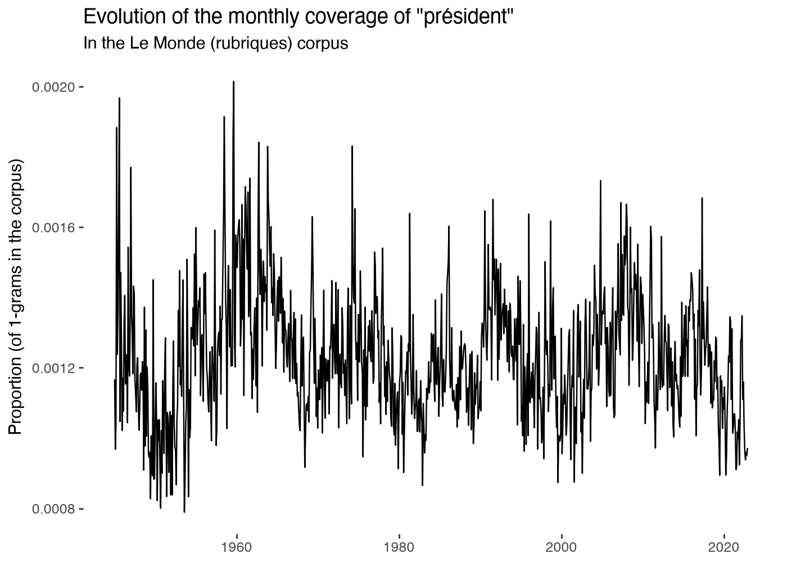
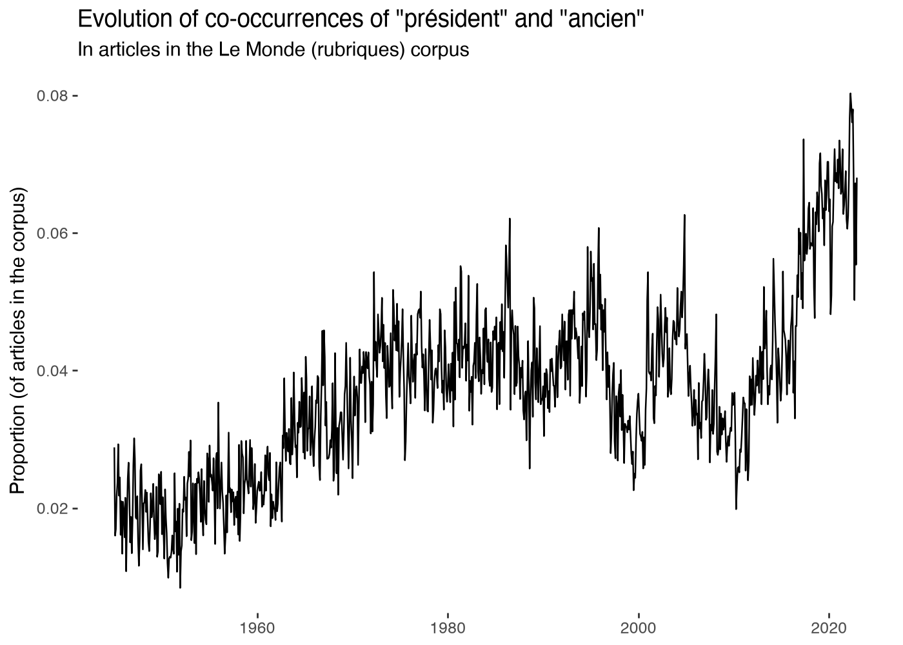
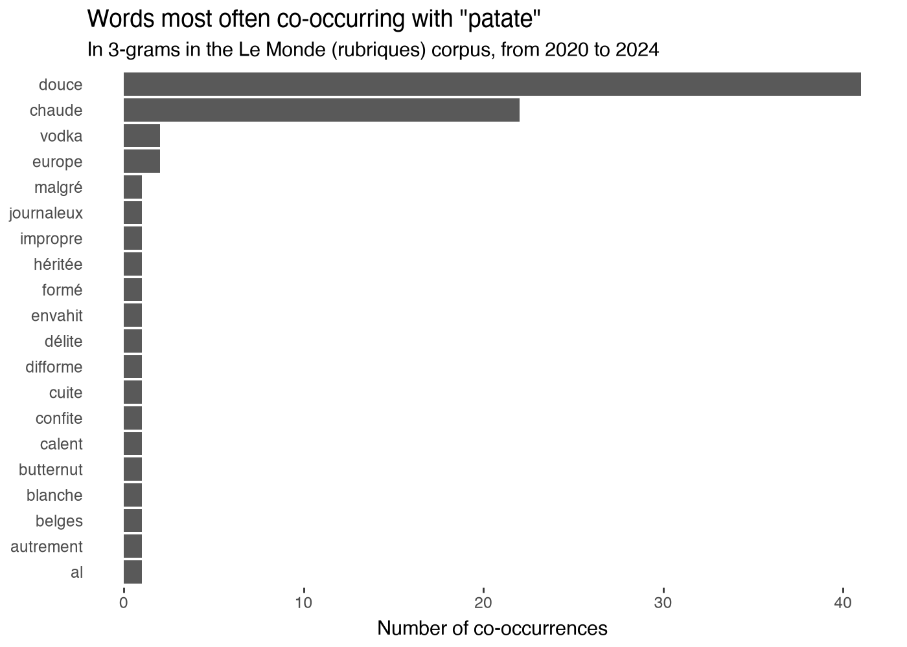

# gallicagraph

::: pyllicagram.gallicagraph

## Examples, with their outputs

``` python
gallicagraph(gallicagram("président"))
```



``` python
gallicagraph(gallicagram_cooccur("président", "ancien", cooccur_level="articles"))
```



``` python
gallicagraph(gallicagram_associated("patate", from_=2020))
```



