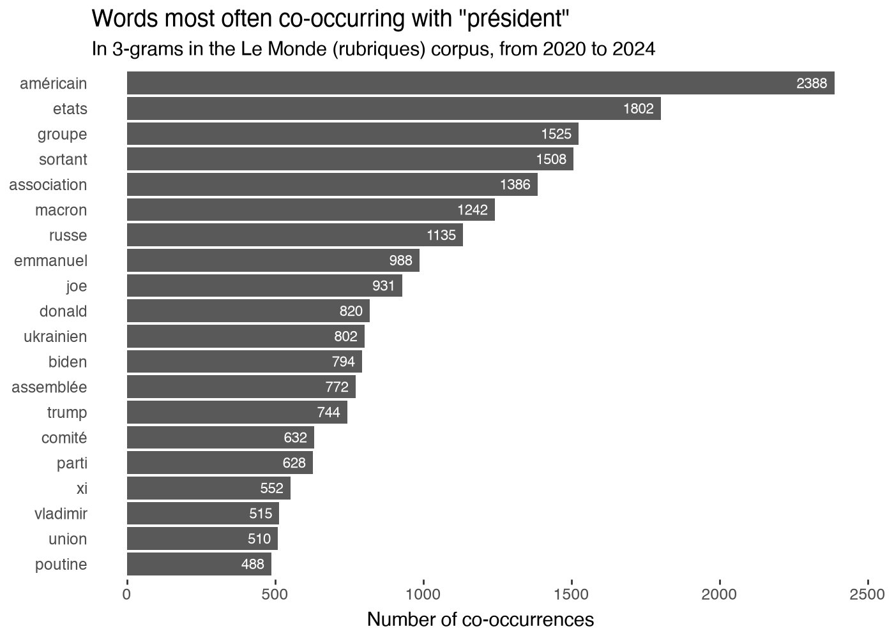

# gallicagraph_associated

::: pyllicagram.gallicagraph_associated

## Examples, with their outputs

``` python
gallicagraph_associated(gallicagram_associated("président", from_=2020), labels_color="white")
```



