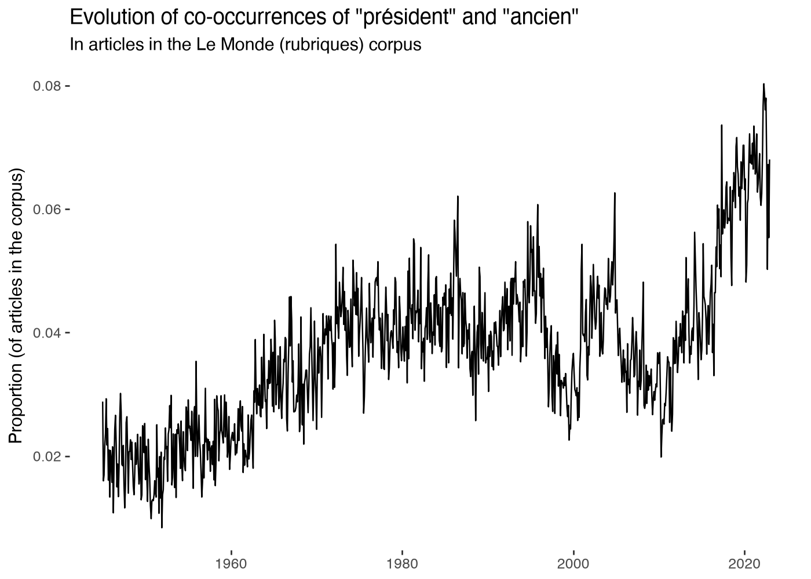
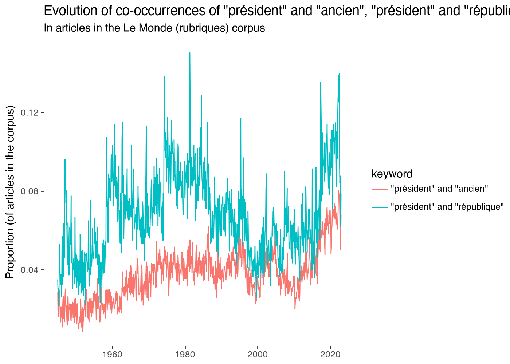
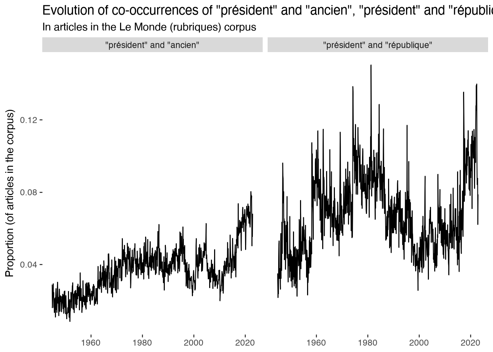

# gallicagraph_cooccur

::: pyllicagram.gallicagraph_cooccur

## Examples, with their outputs

``` python
import pandas as pd
```

``` python
import plotnine
```

``` python
ancien = gallicagram_cooccur("président", "ancien", cooccur_level="articles")
```

``` python
gallicagraph_cooccur(ancien)
```



``` python
both = pd.concat([ancien, gallicagram_cooccur("président", "république", cooccur_level="articles")])
```

``` python
gallicagraph_cooccur(both, color="keyword")
```



``` python
gallicagraph_cooccur(both) + plotnine.facet_wrap("keyword")
```



