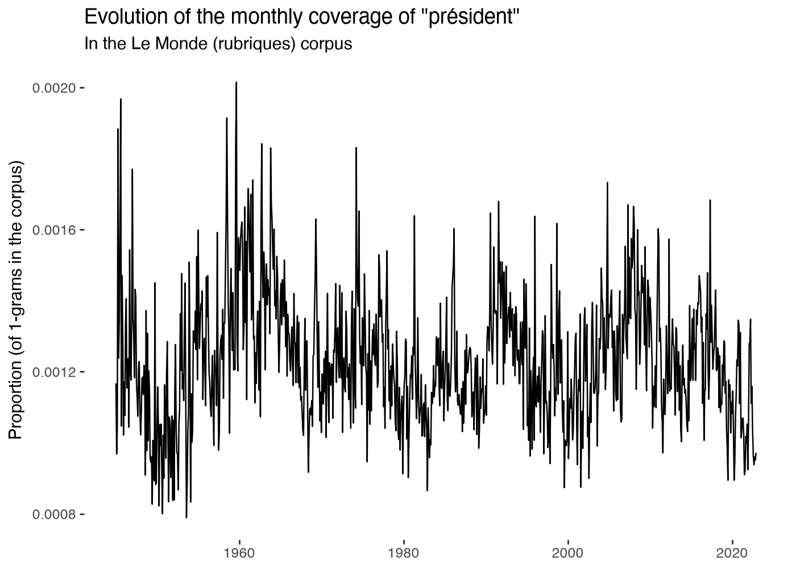
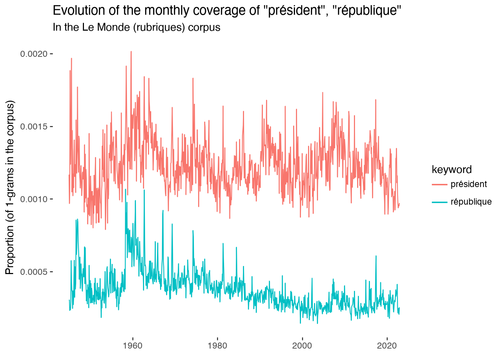
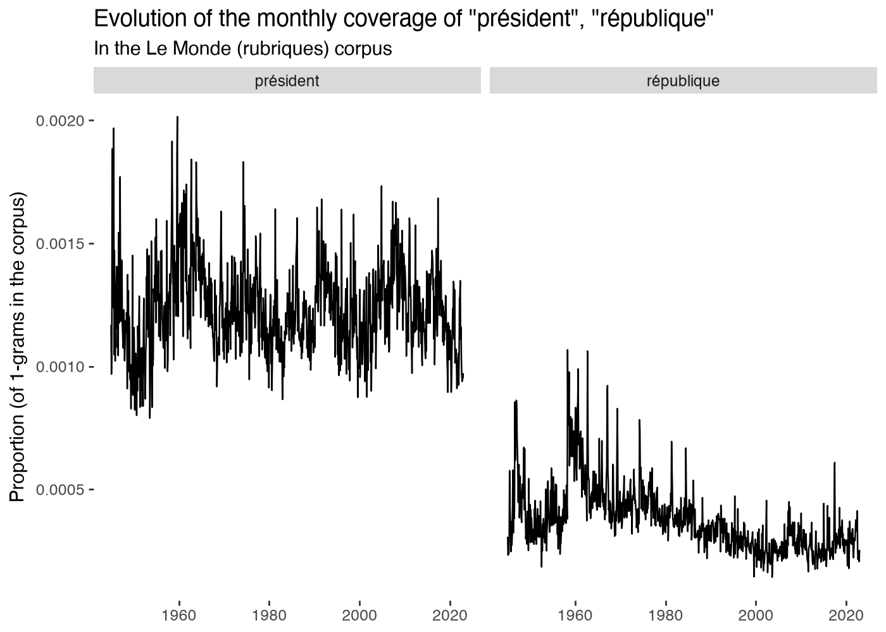
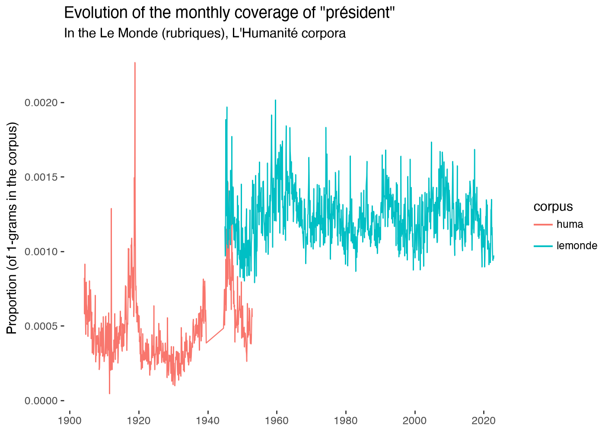

# gallicagraph_occur

::: pyllicagram.gallicagraph_occur

## Examples, with their outputs

``` python
import pandas as pd
```

``` python
import plotnine
```

``` python
gallicagraph_occur(gallicagram("président"))
```



``` python
both = pd.concat([gallicagram("président"), gallicagram("république")])
```

``` python
gallicagraph_occur(both, color="keyword")
```



``` python
gallicagraph_occur(both) + plotnine.facet_wrap("keyword")
```



``` python
corpora = pd.concat([gallicagram("président"), gallicagram("président", corpus="huma")])
```

``` python
gallicagraph_occur(corpora, color="corpus")
```



